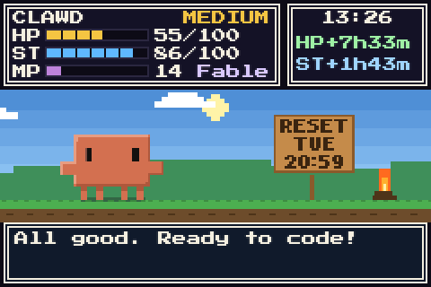
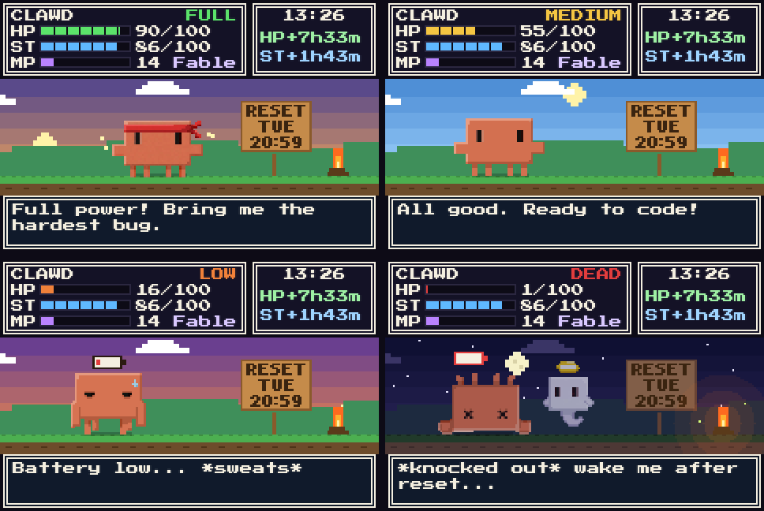

**ภาษา:** [English](README.md) | ไทย

# Usage Wall

ตัวแสดงการใช้งาน **Claude Code** แบบ pixel art บน Mac มี Clawd ตัวเล็กอาศัยอยู่บนจอเสริม (หรือในหน้าต่าง)
เดินเล่นตอนแพ็กเกจยังเหลือเยอะ เหงื่อแตกตอนใกล้ชน weekly limit และล้มหงายเมื่อหมด



[](LICENSE)

[](https://ko-fi.com/porgeeratad)
[](https://buymeacoffee.com/porgeeratad)

> โปรเจกต์แฟนเมดที่ไม่เป็นทางการ ไม่ได้เกี่ยวข้องหรือได้รับการรับรองจาก Anthropic ดู[ข้อจำกัดความรับผิดชอบ](#ข้อจำกัดความรับผิดชอบ)

## หน้าจอบอกอะไร



| | ความหมาย |
|---|---|
| **HP** | weekly limit ที่เหลือ (100 − % ที่ใช้ไป) |
| **ST** | limit รอบ 5 ชั่วโมงที่เหลือ |
| **MP** | weekly limit เฉพาะรุ่นโมเดลที่เหลือ (ถ้าแพ็กเกจมี) |
| **ป้าย RESET** | วันและเวลาที่ weekly limit รีเซ็ต |

สถานะของ Clawd ตาม HP: **FULL** 70–100 (คาดผ้าแดง เดินเร็ว กระโดด) · **MEDIUM** 35–69 (เดินเล่น) ·
**LOW** 5–34 (ตาปรือ เหงื่อแตก ลากเท้า มีแบตเหนือหัว) · **DEAD** ต่ำกว่า 5 (ล้มหงาย ขากระตุก มีผีลอยอยู่ข้างๆ)
ฉากเปลี่ยนตามเวลาจริง ทั้งพระอาทิตย์ พระจันทร์ ดาว หิ่งห้อย และกองไฟตอนกลางคืน

## สิ่งที่ต้องมี

- macOS 14 (Sonoma) ขึ้นไป build ได้ทั้ง Apple silicon และ Intel (ทดสอบแล้วบน Apple silicon)
- Xcode Command Line Tools (`xcode-select --install`) สำหรับ build แอป และมี `/usr/bin/python3` มาด้วย
- Claude Code ที่ล็อกอินด้วยแพ็กเกจ **Pro หรือ Max** (`claude` แล้ว `/login`)

## ติดตั้ง

```sh
git clone https://github.com/porgeeratad/usage-wall.git
cd usage-wall
./install.sh
```

ตัวติดตั้งจะ build แอปจากซอร์ส วางไว้ที่ `~/Applications/Usage Wall.app` เพิ่มคำสั่ง `usage-wall` ใน `~/.local/bin`
ตั้ง status line ของ Claude Code ให้ส่งตัวเลขให้แอป (เฉพาะเมื่อยังไม่มี status line) ถามว่าจะให้แสดงบนจอไหน
แล้วตั้งให้เปิดเองตอนล็อกอิน

```sh
./install.sh --display "DELL U2424HE"   # ไม่ต้องถาม: ใส่ชื่อจอ หรือ auto หรือ window
./install.sh --use-signin               # อ่านการใช้งานด้วยการล็อกอิน Claude ด้วย (ดูด้านล่าง)
./install.sh --no-statusline            # ไม่แตะ status line ของ Claude Code
./install.sh --no-login                 # ไม่ต้องเปิดตอนล็อกอิน
```

## ตัวเลขมาจากไหน

**Status line (ค่าเริ่มต้น)** หลังทุกคำตอบ Claude Code จะรันคำสั่ง status line และส่ง limit ของแพ็กเกจ (`rate_limits`)
มาให้ สคริปต์ของ Usage Wall เก็บค่านั้นไว้ให้แอป เป็นฟีเจอร์ที่ Claude Code รองรับอยู่แล้ว ไม่ใช้ token ไม่ต่อเน็ตเพิ่ม
ตัวเลขจะอัปเดตตอนใช้ Claude Code และเมื่อเลยเวลารีเซ็ตจะนับเป็น 0% จนกว่าจะใช้ครั้งถัดไป (โหมดนี้ไม่มีแถบ MP)
ถ้ามี status line ของตัวเองอยู่แล้ว ให้ส่ง JSON ต่อให้สคริปต์ของแอปด้วย:

```sh
printf '%s' "$input" | ~/.local/bin/usage-wall-statusline >/dev/null
```

**การล็อกอิน Claude (ต้องเปิดเอง)** เมนู → **Read Usage with Claude Sign-in…** หรือ `usage-wall signin on`
แอปจะอ่าน token ล็อกอินของ Claude Code จาก Keychain แล้วถาม endpoint เดียวกับคำสั่ง `/usage` ทุก 10 นาที
ตัวเลขจึงสดแม้ไม่ได้ใช้ Claude Code และมีแถบ MP แต่ endpoint นี้**ไม่มีเอกสาร** ไม่ใช่ฟีเจอร์ทางการของ Anthropic
อาจหยุดทำงานได้ทุกเมื่อ และใช้กับบัญชีของคุณเองตามความเสี่ยงของคุณ ถ้า macOS ถามเรื่อง **"Claude Code-credentials"**
ให้กด **Always Allow**

อัปเดต: `git pull && ./install.sh` (การตั้งค่าเดิมยังอยู่) · ถอนการติดตั้ง: `./uninstall.sh`

## เลือกจอแสดงผล

คลิกไอคอนเกจบน menu bar → **Show On**

- **จอเสริม** (จอที่ไม่ใช่จอหลัก): เต็มจอทุกขอบ อยู่ทุก Space ไม่แย่งโฟกัส ถอดแล้วเสียบใหม่ก็กลับมาเอง
- **จอหลัก** หรือ **Floating Window**: หน้าต่างธรรมดา ย้ายและย่อขยายได้ (คงสัดส่วน 3:2) เลือก **Keep Window on Top**
  เพื่อให้อยู่บนสุด
- **Automatic**: ใช้จอเสริมที่เล็กที่สุดถ้ามี ไม่มีก็เป็นหน้าต่าง

แอปจะไม่ปิดทับจอที่มี menu bar ทำให้กดเมนูของแอปได้เสมอ

```sh
usage-wall display list
usage-wall display set "DELL U2424HE"
usage-wall display set window
```

ออกแบบมาสำหรับจอเล็ก 3.5" แบบ USB-C/HDMI (960×640) แต่ใช้กับจอขนาดไหนก็ได้ หน้าจะย่อขยายให้พอดีเอง

## คำสั่ง

`usage-wall status` · `display [list|set NAME]` · `reload` · `open` · `start` / `stop` · `login on|off` ·
`signin on|off` · `logs` · `config` · `version`

## ความเป็นส่วนตัวและความปลอดภัย

- ค่าเริ่มต้นไม่ต่อเน็ตเลยและไม่แตะการล็อกอินของคุณ ตัวเลขมาจาก status line ของ Claude Code
- โหมดล็อกอิน (เปิดเอง) ติดต่อที่เดียวคือ `api.anthropic.com` ด้วย token ของคุณเอง อ่าน token จาก Keychain เฉพาะตอนใช้
  เก็บในหน่วยความจำแค่คำขอเดียว ไม่เขียนลงไฟล์และไม่ลง log
- ไม่มี analytics หรือ telemetry
- server ภายในฟังแค่ 127.0.0.1 รับเฉพาะคำขอที่ส่งถึง `127.0.0.1`/`localhost` และคำสั่งเขียนต้องมี header เฉพาะที่เว็บอื่นส่งไม่ได้
- ข้อมูลทั้งหมดอยู่ใน `~/Library/Application Support/UsageWall/` และ `~/Library/Logs/UsageWall.log`

## แก้ปัญหา

| หน้าจอขึ้นว่า | ทำแบบนี้ |
|---|---|
| "Waiting for Claude Code's status line" | ใช้ Claude Code สักครั้ง ถ้ายังขึ้นอยู่ ดูหัวข้อ "ตัวเลขมาจากไหน" |
| "Sign in to Claude Code (Pro/Max)" | รัน `claude` แล้ว `/login` (โหมดล็อกอิน) |
| "Claude sign-in expired" | เปิด Claude Code หนึ่งครั้งให้ต่ออายุการล็อกอิน |
| "Usage API busy. Retrying in …" | ไม่ต้องทำอะไร แอปจะรอแล้วลองใหม่เอง |
| "Lost contact with the usage server" | `usage-wall start` หรือดู `usage-wall logs` |

รายละเอียดเพิ่มเติม: [docs/TROUBLESHOOTING.md](docs/TROUBLESHOOTING.md)

## สนับสนุนโปรเจกต์

ถ้า Usage Wall ทำให้โต๊ะทำงานสนุกขึ้น สนับสนุนได้ที่

- ☕ [ko-fi.com/porgeeratad](https://ko-fi.com/porgeeratad)
- 🍪 [buymeacoffee.com/porgeeratad](https://buymeacoffee.com/porgeeratad)

กดดาว แจ้งบั๊ก หรือส่ง pull request ก็ช่วยได้มาก

## ข้อจำกัดความรับผิดชอบ

Usage Wall เป็นโปรเจกต์แฟนเมดที่ไม่เป็นทางการ ไม่ได้เกี่ยวข้อง ไม่ได้รับการรับรอง และไม่ได้รับการสนับสนุนจาก Anthropic
Claude, Claude Code และ Clawd เป็นเครื่องหมายการค้าของ Anthropic, PBC ตัวเลขการใช้งานมาจาก endpoint ที่ไม่มีเอกสาร
ซึ่ง Claude Code ใช้เอง อาจเปลี่ยนหรือหยุดทำงานได้ทุกเมื่อ การใช้งานกับบัญชีของคุณเป็นความเสี่ยงของคุณเอง

## License

โค้ด: [MIT](LICENSE) · ภาพ: ใช้และแจกต่อได้เมื่อเป็นส่วนหนึ่งของ Usage Wall และ fork ของมัน ([art/README.md](art/README.md)) ·
ฟอนต์: [SIL OFL](web/fonts/OFL.txt)
